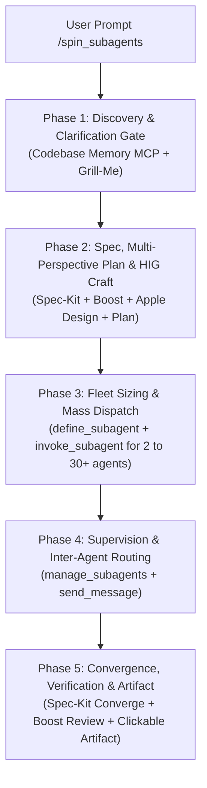

# Unified Subagent Orchestrator: `/spin_subagents`

The `/spin_subagents` engine is an all-in-one multi-agent orchestrator for the Antigravity harness. It synthesizes proven architectural patterns from eight core systems:

1. **Antigravity Harness Native Subagents**: Built-in agents (`self`, `research`, `image-generator`, `flutter_a11y_agent`) and agent primitives (`invoke_subagent`, `define_subagent`, `manage_subagents`, `send_message`).
2. **`/teamwork-preview`**: Dynamic work-package partitioning, role-specialized team generation, and parallel orchestrator/worker execution.
3. **`/boost`**: Deep thinking, multi-perspective strategic planning, adversarial stress-testing, and rigorous verification contracts.
4. **`/grill-me`**: Rapid up-front de-risking and clarification to resolve critical decision forks before burning compute.
5. **`/plan`**: Architectural design, milestone sequencing, and dependency graphs.
6. **`Spec-Kit` (SDD)**: Spec-Driven Development: functional specs (`spec.md`), work breakdown (`tasks.md`), contracts, and convergence auditing (`converge`).
7. **`apple-design`**: Human Interface Guidelines (HIG), craft, visual hierarchy, touch targets, contrast ratios, and design excellence.
8. **`codebase-memory-mcp`**: Zero-waste structural AST discovery (`search_graph`, `trace_path`, `get_architecture`) consuming 99% fewer tokens than file searches.

---

## The 5-Phase Execution Pipeline

Whenever `/spin_subagents` is triggered with a prompt or task:



---

### Phase 1: Structural Discovery & Clarification Gate

1. **Codebase Structural Ingestion (`codebase-memory-mcp`)**:
   - If in an existing codebase, do NOT start with massive directory grep/globs.
   - Call `get_architecture` to understand top-level modules.
   - Use `search_graph` and `trace_path` to locate key controllers, components, models, and call trees.
2. **The Clarification Gate (`/grill-me`)**:
   - Assess whether the prompt contains high-stakes ambiguity (e.g. unknown deployment target, conflicting tech stacks, missing authentication mechanism).
   - If truly ambiguous: Ask at most **2 to 3 high-impact questions** using `ask_question` with clear selectable options, prefixing the most sensible option with `(Recommended)`.
   - If the intent is sufficiently clear or standard defaults apply: State the working assumptions clearly and proceed immediately into Phase 2 without blocking.

---

### Phase 2: Specification, Multi-Perspective Planning & Design Craft

1. **Spec-Driven Specification (`Spec-Kit`)**:
   - Synthesize requirements into formal user stories and acceptance criteria.
   - Define exact interface boundaries, data schemas, and API contracts.
2. **Multi-Perspective Deep Reasoning (`/boost`)**:
   - Evaluate the plan through 5 distinct lenses:
     - **Architecture**: Modularity, loose coupling, separation of concerns.
     - **Security**: Attack surfaces, trust boundaries, injection/auth vulnerabilities.
     - **Performance**: Latency, token overhead, memory leaks, I/O bottlenecks.
     - **UX & Ergonomics**: Smooth user journeys, error handling, feedback loops.
     - **Reliability & Verifiability**: Deterministic testing criteria, rollback safety.
3. **Apple Design Craftsmanship (`apple-design`)**:
   - For all frontend, UI, mobile, or web components, apply Apple HIG rules:
     - **Tap Targets**: Minimum 44x44pt (iOS/Web) or 48x48dp (Android).
     - **Visual Contrast**: 4.5:1 for standard text, 3:1 for large text (WCAG AA).
     - **Typography**: System font scales, dynamic type support, semantic text styles.
     - **Layout & Structure**: Clear visual hierarchy, generous breathing room, avoiding generic templated layouts.
4. **Atomic Task Graph (`tasks.md`)**:
   - Break the scope down into independent, parallelizable **Work Packages (WPs)** (e.g., `WP-01`, `WP-02`, ... `WP-N`).
   - Flag dependencies so parallel subagents do not conflict on the same file paths.

---

### Phase 3: Fleet Sizing & Mass Parallel Dispatch

1. **Calculate Required Fleet Size**:
   - Scale the subagent team dynamically to match the problem:
     - **Targeted Feature / Bugfix**: 2 to 6 subagents.
     - **Full Module / Multi-Page App**: 8 to 15 subagents.
     - **Large-Scale Architecture / Monorepo Sweep**: **20 to 30 subagents**.
2. **Dynamic Subagent Role Configuration**:
   - Select from built-in agents (`self`, `research`, `image-generator`, `flutter_a11y_agent`) or dynamically define custom agent roles with `define_subagent`:
     - `research-scout`: Broad documentation, API lookups, and web search.
     - `code-builder`: Heavy implementation, refactoring, and code writing.
     - `apple-ui-crafter`: UI layout, CSS/Tailwind, SwiftUI, or Flutter widgets following Apple HIG.
     - `test-engineer`: Unit, integration, and mock generation.
     - `security-hunter`: Boundary, auth, and invariant validation.
     - `accessibility-auditor`: WCAG semantic labels, tap bounds, screen reader flows.
     - `doc-synthesizer`: API specs, markdown summaries, and usage guides.
3. **Mass Dispatch via `invoke_subagent`**:
   - **Crucial Rule**: Dispatch the entire fleet concurrently in a **single call** to `invoke_subagent` by populating the `Subagents` array with all worker definitions:
     ```json
     {
       "Subagents": [
         {
           "TypeName": "self",
           "Role": "UI Layout Crafter",
           "Prompt": "Implement WP-01: Header & Navigation according to Apple HIG. Output to tmp/wps/wp01.md"
         },
         {
           "TypeName": "self",
           "Role": "Backend API Builder",
           "Prompt": "Implement WP-02: REST API endpoints for User Service. Output to tmp/wps/wp02.md"
         },
         {
           "TypeName": "research",
           "Role": "Docs & Schema Researcher",
           "Prompt": "Extract and verify third-party SDK signatures. Output to tmp/wps/wp03.md"
         }
         // ... up to 20 or 30 subagents in one call!
       ]
     }
     ```
   - **Prompt Guardrails for Subagents**:
     - Assign an explicit, isolated scope (specific files, endpoints, or screens).
     - Provide the shared contract and design standards directly in their prompt.
     - Assign a unique output path (e.g., `<scratchDir>/wps/wp<N>_report.md`).
     - Instruct workers **not** to spawn nested subagents unless explicitly designated as middle-tier sub-orchestrators.

---

### Phase 4: Supervision, Inter-Agent Messaging & Routing

1. **Reactive Wakeup**:
   - The Antigravity harness automatically resumes execution when subagents send messages or complete their tasks. Never poll in a busy loop.
2. **Coordination (`send_message` & `manage_subagents`)**:
   - Use `manage_subagents` with `Action: "list"` to check active agent states.
   - If Worker B requires an API schema finalized by Worker A, use `send_message` to route Worker A's output directly to Worker B.

---

### Phase 5: Convergence, Verification & Artifact Reporting

1. **Convergence Check (`Spec-Kit Converge`)**:
   - Validate that each Work Package output satisfies the original specification contracts.
   - Sweep for interface alignment, lint errors, and test pass rates.
2. **Quality Verification (`/boost` Review Pass)**:
   - Perform an adversarial sanity check on the combined codebase.
   - Check that UI elements meet Apple HIG and WCAG accessibility standards.
3. **Antigravity Artifact Output**:
   - Create a comprehensive markdown artifact in the conversation artifact directory (`<appDataDir>\brain\<conversation-id>\spin_subagents_report.md`).
   - Always include:
     - **Mermaid Architecture Diagram**: Visualizing the subagent team hierarchy and data flow.
     - **Work Package Ledger**: Status table for all spawned subagents (Role, Model, Scope, Result).
     - **Clickable Markdown Links**: Links using `file:///` format to every touched file and subagent report.
     - **Verification Summary**: Test runs, security invariant checks, and design audit pass status.
